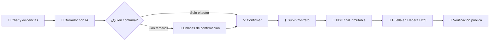

<div align="center">

<picture>
  <source media="(prefers-color-scheme: dark)" srcset="public/galcoa-on-dark.svg">
  
</picture>

### Registros con respaldo, rastro y control de calidad

Contá la operación por chat. La IA la redacta y la contrasta con tus pruebas, las partes la confirman con un enlace y su **huella queda registrada en Hedera**.

[](https://github.com/nanonoir/galcoa/actions/workflows/ci.yml)


**[Demo en vivo](https://galcoa.noirnahuel.com)** · [Cómo funciona](#-cómo-funciona) · [Instalación](#-instalación-local) · [Despliegue](#-despliegue) · [Testing](#-testing) · [Documentación](#-documentación)

</div>

---

## ✨ Qué es

GALCOA+ documenta operaciones comerciales (ventas, entregas, acuerdos de campo) **conversando**:

| | |
| --- | --- |
| 💬 **Chat + evidencias** | Contás la operación con tus palabras y adjuntás fotos o PDFs (facturas, remitos). |
| 🤖 **Redacción asistida** | Gemini extrae el texto de las pruebas y redacta un borrador estructurado. |
| 👀 **Vista previa** | Revisás el PDF antes de cerrar nada. |
| ✅ **Confirmación** | Confirmás vos solo, o compartís un enlace con intermediario y/o comprador: todos confirman **la misma versión congelada**. |
| ⬆️ **Subir Contrato** | Se genera el PDF final (inmutable) y su **huella SHA-256** se publica en **Hedera Consensus Service (Testnet)**. |
| 🔎 **Verificación pública** | Cualquiera puede comprobar la huella en `/verify/<referencia>` o en HashScan, sin acceder al contenido. |

> A Hedera solo viajan **hashes e identificadores opacos**: el contenido del documento nunca se publica.

## 🧭 Cómo funciona



1. **Creá un documento** desde *Mis documentos* y renombralo cuando quieras (se autotitula con el primer borrador).
2. **Conversá**: describí la operación y adjuntá pruebas; el agente redacta el borrador.
3. **Revisar 👁**: abrí la vista previa del PDF.
4. **Confirmar** (si sos el único participante) o **Compartir con terceros** para que confirmen por enlace.
5. **Subir Contrato ⬆️**: espera con un indicador hasta que la huella quede registrada y deja fija la constancia con los enlaces de verificación.

## 🧱 Stack

| Capa | Tecnología |
| --- | --- |
| App | Next.js 16 (App Router) · React 19 · TypeScript · Tailwind CSS v4 · shadcn/ui |
| Datos | Supabase: Auth, Postgres con RLS y funciones `SECURITY DEFINER`, Storage privado |
| IA | Gemini (extracción y redacción) · GPT-OSS 120B en Groq (contraste) · Zod para salidas estructuradas |
| Documento | `@react-pdf/renderer` · SHA-256 · manifiesto canónico (JCS) |
| Blockchain | Hedera Consensus Service con `@hiero-ledger/sdk` · Mirror Node para reconciliar · **solo Testnet** |
| Calidad | Vitest · Playwright · ESLint · barreras de arquitectura · GitHub Actions |
| Despliegue | Docker (Next.js `standalone`) en VPS detrás de Cloudflare Tunnel · compatible con Vercel |

## 📁 Estructura

```text
src/
├── app/                 # Rutas (App Router): páginas privadas, landing, /confirm, /verify y API
├── features/            # Por dominio: chat, corroborations, documents, dashboard, marketing, auth
│   └── <dominio>/{components,containers,contracts}
├── lib/                 # Servidor y contratos: documents, ai, hedera, supabase, contracts (Zod)
└── components/ui/       # Primitivas shadcn
supabase/migrations/     # Esquema, RLS y funciones (fuente de verdad de la base)
tests/                   # server, rls, e2e (Playwright)
preview/                 # Preview local de componentes con datos ficticios (sin credenciales)
docs/                    # PRD, arquitectura, desarrollo, planes y deuda técnica
```

Más detalle en [`docs/architecture.md`](docs/architecture.md).

## 🚀 Instalación local

### Requisitos

- **Node.js 24.18** (`.nvmrc`) y **npm ≥ 11**
- Para la base local: **Docker** y la CLI de Supabase (`npx supabase`)
- Cuentas propias (solo si querés el flujo completo): Supabase, Google AI (Gemini), Groq y una cuenta Hedera **Testnet** ([portal](https://portal.hedera.com))

### 1. Probar la interfaz sin credenciales (2 minutos)

```bash
git clone https://github.com/nanonoir/galcoa.git
cd galcoa
npm ci
npm run preview:ui
```

El preview monta los componentes reales con escenarios ficticios. No necesita `.env`, red ni servicios.

### 2. Aplicación completa con Supabase local

```bash
npx supabase start                 # Postgres, Auth y Storage locales (Docker); aplica supabase/migrations
npx supabase status                # URL y claves locales para el .env
cp .env.example .env               # completá los valores (ver tabla)
npm run dev                        # http://localhost:3000
```

La conexión del rol limitado `galcoa_exec_login` (`GALCOA_EXECUTOR_DATABASE_URL`) se provisiona aparte; seguí [Ejecutor interno](docs/development.md#ejecutor-interno-f4-provisión-privada-del-operador).

> Usá **un único** archivo `.env` en la raíz. **Nunca** `.env.local`: Next le da prioridad y `npm run env:check` lo bloquea. Si te pasan un `.env`, instalalo sin leerlo con `npm run env:install -- <ruta>`.

### Variables de entorno

| Variable | Dónde | Para qué |
| --- | --- | --- |
| `NEXT_PUBLIC_SUPABASE_URL` | cliente + servidor | URL base del proyecto (`https://<ref>.supabase.co`, sin `/rest/v1`) |
| `NEXT_PUBLIC_SUPABASE_PUBLISHABLE_KEY` | cliente + servidor | Clave publicable de Supabase |
| `NEXT_PUBLIC_APP_URL` | cliente + servidor | Origen de confianza de la app (p. ej. `http://localhost:3000`) |
| `SUPABASE_SECRET_KEY` | solo servidor | Operaciones de servidor de Supabase |
| `GALCOA_EXECUTOR_DATABASE_URL` | solo servidor | Conexión Postgres del rol limitado `galcoa_exec_login` (pooler en la nube) |
| `GALCOA_EXECUTOR_DATABASE_CA` | solo servidor | Certificado CA de Supabase para TLS con el pooler (obligatorio en la nube) |
| `GOOGLE_GENERATIVE_AI_API_KEY` | solo servidor | Gemini: extracción y redacción |
| `GROQ_API_KEY` | solo servidor | Groq: contraste |
| `HEDERA_NETWORK` | solo servidor | Siempre `testnet` (otra red se rechaza) |
| `HEDERA_OPERATOR_ID` / `HEDERA_OPERATOR_KEY` | solo servidor | Cuenta operadora de Testnet |
| `HEDERA_TOPIC_ID` | solo servidor | Topic HCS donde se publican las huellas |

Solo las `NEXT_PUBLIC_*` llegan al navegador. Las claves nunca van a commits, logs ni capturas.

## ☁️ Despliegue

### Opción A — Docker en un VPS (producción actual)

Guía completa: [`docs/DEPLOY-VPS.md`](docs/DEPLOY-VPS.md).

```bash
cp .env.production.example .env.production && chmod 600 .env.production   # completar valores
docker compose --env-file .env.production build
docker compose --env-file .env.production up -d
curl -fsS http://127.0.0.1:3001/api/health                                  # {"status":"ok"}
```

Checklist que evita los errores más comunes:

- [ ] **Migraciones aplicadas** en el proyecto Supabase: `npx supabase link --project-ref <ref>` y `npx supabase db push`. Si faltan funciones, la app responde `TECHNICAL_FAILURE`.
- [ ] `GALCOA_EXECUTOR_DATABASE_URL` apunta al **pooler** (`*.pooler.supabase.com:6543`, usuario `galcoa_exec_login.<ref>`), no a `db.<ref>.supabase.co`, que solo responde por IPv6.
- [ ] `GALCOA_EXECUTOR_DATABASE_CA` contiene el certificado de *Database Settings → SSL Configuration*, entre comillas dobles y con sus saltos de línea.
- [ ] Tras cambiar `.env.production`: `docker compose --env-file .env.production up -d --force-recreate` (`restart` no relee el archivo).
- [ ] En Supabase Auth, *Site URL* y *Redirect URLs* con tu dominio (`…/api/auth/callback**`).

### Opción B — Vercel

Importá el repo, cargá las mismas variables en *Project Settings → Environment Variables* y desplegá. `output: "standalone"` es ignorado por Vercel.

## 🧪 Testing

| Comando | Qué cubre | Requiere |
| --- | --- | --- |
| `npm run lint` | ESLint | — |
| `npm run typecheck` | Tipos de rutas Next + `tsc --noEmit` | — |
| `npm test` | Vitest: contratos, servicios, rutas y componentes (~1400 tests) | — |
| `npm run test:boundaries` | Barreras de imports entre capas | — |
| `npm run build` | Build de producción | — |
| `npm run test:e2e` | Playwright: preview, landing, accesibilidad y responsive | `npx playwright install chromium` |
| `npm run test:rls` | RLS, grants e inmutabilidad contra Postgres real | Docker + `npx supabase start` |
| `npm run test:server:local` | Servidor, Auth y concurrencia contra la pila local | Docker + `npx supabase start` |
| `npm run test:e2e:review` · `test:e2e:confirm` · `test:e2e:auth` | Recorridos de navegador con datos sembrados | Docker + Supabase local |

Validación rápida antes de un PR:

```bash
npm run lint && npm run typecheck && npm test && npm run test:boundaries && npm run build
```

GitHub Actions ([`ci.yml`](.github/workflows/ci.yml)) corre esos checks, Playwright y las suites seriales contra un Supabase efímero en Linux.

## 🛡️ Reglas que el código garantiza

- **Inmutabilidad:** las versiones finalizadas, sus PDFs y hashes no se modifican ni se borran.
- **Misma versión para todos:** cada participante confirma el mismo snapshot congelado; un cambio crea otra revisión.
- **Enlaces seguros:** abrir un enlace de confirmación no lo consume; responder es atómico e idempotente.
- **Privacidad en blockchain:** a Hedera solo van hashes e identificadores opacos, y solo en Testnet.
- **Lenguaje honesto:** el sistema no emite «certificados», no ofrece «firma digital» ni «identidad verificada», y no garantiza que los datos sean verdaderos. Deja constancia de quién confirmó y de que el documento no cambió.

## ⚠️ Limitaciones del MVP

- Es una **demostración**: Hedera **Testnet** puede reiniciarse; usá datos ficticios.
- Para la demo, las **advertencias de la IA están ocultas** (`DEMO_HIDE_WARNINGS`); ver [deuda técnica §9](docs/exec-plans/tech-debt-tracker.md).
- Los enlaces de confirmación se comparten manualmente (WhatsApp, correo o QR).
- Fuera de alcance: Mainnet, pagos, audio e invitaciones automáticas.

## 📚 Documentación

| Necesitás… | Leé |
| --- | --- |
| Qué construir y por qué | [PRD](docs/exec-plans/GALCOA-PRD-v1.4.md) |
| Arquitectura y límites | [`docs/architecture.md`](docs/architecture.md) |
| Desarrollo, validación y seguridad | [`docs/development.md`](docs/development.md) |
| Despliegue en VPS | [`docs/DEPLOY-VPS.md`](docs/DEPLOY-VPS.md) |
| Guía visual | [`design.md`](design.md) |
| Planes y deuda técnica | [`docs/exec-plans/`](docs/exec-plans/) · [deuda técnica](docs/exec-plans/tech-debt-tracker.md) |
| Trabajar con agentes de IA | [`AGENTS.md`](AGENTS.md) |

## 👥 Equipo

Proyecto final para la **Ideathon Hedera · NEA Tech 2026**.

Gastón Persoglia · Nahuel Noir · Facundo Ayala · Federico Fontana · Thomas Skarp
