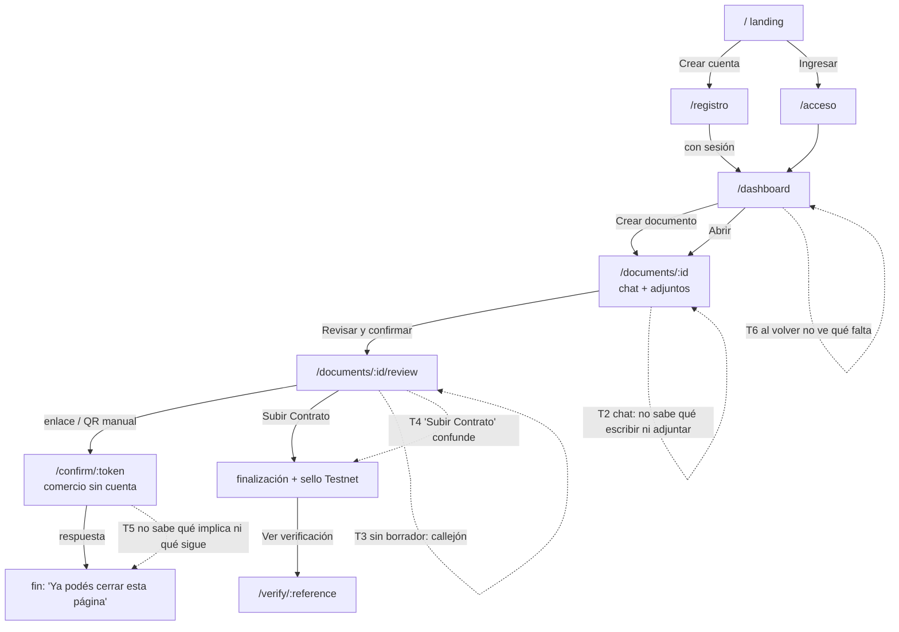
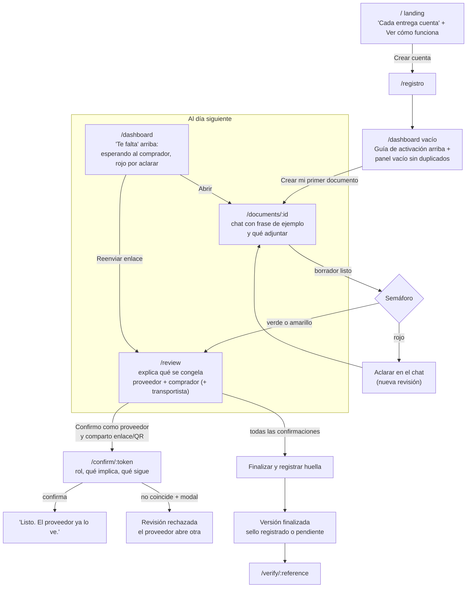

# ExecPlan — Onboarding: pantallas, flujo de usuario y demo

Estado: **implementado e integrado** (octubre 2026). Definición del 2026-10-22 implementada en PR #156 e integrada con el PR #157 en la rama `integration/onboarding-conversion` ([plan de integración archivado](../completed/integracion-onboarding-conversion.md), [PR #158](https://github.com/nanonoir/galcoa/pull/158)). Pedido de Nahuel: «Definir bien las pantallas y el flujo de usuario + una demo, para que los usuarios nuevos se adapten rápido e integren GALCOA+ a su flujo de trabajo normal». Rama origen: `feat/onboarding-flujo-usuario`.

## Resumen (leer primero)

1. Hoy el flujo completo existe en código, pero un usuario nuevo entra a un panel vacío y nadie le explica el camino ni sus tres momentos: **contar, pedir confirmación y quedar respaldado**.
2. Encontramos **8 puntos donde se traba**: panel vacío sin ejemplo, chat sin frase guía, «Subir Contrato» (no es un contrato), revisión sin borrador sin salida, tercero sin «qué pasa después», pendientes difíciles de ver, sin pantallas propias de error/404 y vocabulario técnico (HCS, snapshot, hash).
3. Propuesta y resultado: **no hacer un tour largo**. Enseñar en el lugar: guía de activación arriba (`ActivationChecklistCard`) y panel vacío limpio sin duplicar pasos (`DashboardReference`), chat con ejemplo de frase, revisión que explica qué se congela y una pantalla del comercio que dice qué implica confirmar.
4. **Facu** puede hacer solo, en presentación, 10 tickets chicos (F-1 a F-10). **Nahuel** tiene 9 (N-1 a N-9): rutas, contratos, datos de demo, cuenta de demo, documentación de demo y bloqueos del servidor.
5. La demo para usuario nuevo dura **4 minutos** y usa tres casos ficticios ya preparados: **verde** (se confirma y se sella), **rojo** (200/198, no se sella) y **finalizado** (para verificar el PDF).
6. El runbook de jurados está **desactualizado**: dice que una advertencia crítica no bloquea. Con la regla ALC vigente, **el rojo bloquea**. Hay que corregirlo antes de cualquier demo (N-6).
7. El preview (`npm run preview:ui`) **no sirve** como demo de producto: no tiene chat, revisión, confirmación, verificador ni semáforo ALC.
8. Hay **7 preguntas para Nahuel** (al final): la más urgente es si la demo usa una cuenta compartida preparada y quién la crea.
9. Un solo discurso para landing, onboarding y demo (ver «Discurso»): **GALCOA+ verifica operaciones entre partes; empezamos por la distribución**.

## Discurso

Todas las pantallas, la demo y la landing usan el mismo mensaje, para que el producto no se contradiga:

> **GALCOA+ verifica operaciones entre partes. Empezamos por la distribución (distribuidora, transportista y comercio), y el mismo método sirve para cualquier empresa que necesite datos confirmados por la otra parte.**

- El onboarding y la demo usan **un solo caso concreto**: una entrega de mercadería. Es lo que mejor se entiende.
- Otros rubros (farma, agro, operaciones internas, alto valor) se nombran como «también sirve para», **nunca como una función propia** (REGLAS §2).
- Lo que se registra en Hedera es **solo una huella**: ni datos de la operación ni datos personales (INV-06). Eso se dice así, sin prometer más.
- Ampliar oficialmente el público objetivo es decisión de Nahuel (pregunta 7).

## Usuarios y su objetivo

Precedencia: [`docs/GALCOA-REGLAS-PRODUCTO.md`](../../GALCOA-REGLAS-PRODUCTO.md) sobre el [PRD](../GALCOA-PRD-v1.4.md). En el código se conservan los IDs `autor`, `intermediario` y `comprador`; en pantalla se muestran **proveedor**, **transportista** y **comprador** ([alineación](alineacion-distribuidoras.md#roles-y-cuatro-ojos-separación-por-documento-no-por-equipo)).

| Usuario | Quién es | Qué quiere lograr | ¿Tiene cuenta? | Dónde lo vive |
| --- | --- | --- | --- | --- |
| **Proveedor** (la distribuidora) | Cliente principal: distribuidora pyme de alimentos y bebidas del NEA (REGLAS §2) | Contar la entrega en un minuto, conseguir la confirmación del comercio y tener una prueba para reclamos o marcas | Sí | `/dashboard`, `/documents/:id`, `/documents/:id/review` |
| **Comprador** (el comercio) | Almacén o negocio que recibe (REGLAS §2) | Confirmar o decir «no coincide» desde el celular, sin crear cuenta, en menos de un minuto | No (enlace o QR) | `/confirm/:token` |
| **Transportista** (opcional) | Quien llevó la mercadería (REGLAS §4) | Confirmar su parte si lo incluyeron | No (enlace o QR) | `/confirm/:token` |
| **Quien verifica** | Cualquiera con la referencia y el PDF (PRD REQ-11) | Comprobar que el PDF no cambió desde que se registró | No | `/verify/:reference` |
| **Marca** | Empresa que evalúa a la distribuidora (REGLAS §2) | Ver el historial que la distribuidora comparte | — | **No existe en P0** (fase 2, F-6) |

Fuera del onboarding P0: organización o empresa, equipos, invitaciones automáticas, audio, indicadores, perfil compartible, pagos y Mainnet (PRD §4 P1; REGLAS §10; [alineación](alineacion-distribuidoras.md)). El onboarding **no** pide «crear tu organización».

## Mapa de pantallas actual

Inventario completo con archivos y estados: `.orquesta/onboarding/notas/01-inventario-pantallas.md` (nota local, no versionada). Resumen:

| Ruta | Para quién | Qué hace hoy | Estado vacío / error |
| --- | --- | --- | --- |
| `/` | Visitante | Landing, «Crear cuenta» / «Ingresar», «Cómo funciona» en 3 pasos, «Próximamente» | Si Auth falla, muestra la versión de visitante sin aviso |
| `/acceso`, `/registro`, `/recuperar`, `/nueva-contrasena` | Proveedor | Acceso con correo; avisos por `?aviso=` | Registro sin sesión emitida = error técnico |
| `/dashboard` | Proveedor | «Mis documentos», «Crear documento», tarjetas con Documento / Confirmaciones / Sello HCS | Vacío: «Todavía no hay documentos.» con el botón fuera del bloque |
| `/documents/:id` | Proveedor | Título, chat, adjuntos, «Revisar» (vista previa), «Revisar y confirmar», historial y tarjeta sellada | Chat vacío: «Todavía no hay mensajes. Contá la operación…» |
| `/documents/:id/review` | Proveedor | Elegir transportista, congelar, enlaces/QR/WhatsApp/correo, confirmar como proveedor, progreso, **«Subir Contrato»** | Sin borrador: un párrafo y ningún enlace |
| `/confirm/:token` | Comprador / transportista | Operación congelada, nombre, casilla, «Confirmar» o «No coincide / Rechazar» con modal | Respondido: «Ya podés cerrar esta página.» |
| `/verify/:reference` | Quien verifica | Estado del registro en Testnet y comparación de un PDF | Error con «Reintentar» y «Volver al inicio» |

No hay `not-found.tsx`, `error.tsx` ni `loading.tsx` propios: se ven las pantallas por defecto de Next.

## Recorrido actual y dónde se traba

| # | Traba | Evidencia | Efecto en un usuario nuevo |
| --- | --- | --- | --- |
| T1 | Panel vacío sin acción propia ni ejemplo | `src/features/dashboard/components/dashboard-reference.tsx:258-264` | No entiende qué es un «documento» ni que el valor está en la confirmación del comercio |
| T2 | Chat vacío genérico; no dice qué adjuntar | `src/features/chat/components/chat-reference.tsx:193` | Escribe poco o mezcla datos, y termina en rojo por ambigüedad (p. ej. número sin unidad) |
| T3 | Revisión sin borrador sin enlace de vuelta | `src/app/(app)/documents/[id]/review/page.tsx:80-82` | Queda en una página muerta |
| T4 | El botón para finalizar dice «Subir Contrato» | `src/features/corroborations/components/finalization-panel.tsx:122` | Cree que sube un contrato; no entiende que finaliza la versión y registra la huella |
| T5 | El tercero no ve rol, consecuencias ni qué sigue | `src/features/corroborations/components/confirmation-screen.tsx:296-311` | Duda o rechaza por las dudas |
| T6 | Lo pendiente no se destaca; no dice quién falta | `dashboard-reference.tsx` (tarjetas sin orden por pendiente) | Al día siguiente abre documento por documento |
| T7 | Sin 404/error propios | árbol de `src/app` | Pantalla en inglés de Next, sin salida |
| T8 | Vocabulario técnico (HCS, snapshot, hash, topic) | `review-progress.tsx:92`, `sealed-version-card.tsx:86-95`, `dashboard-reference.tsx:198-211` | No entiende el estado de su operación |

Además, en el chat la rama «Confirmar» quedó sin uso (`src/features/chat/containers/chat-actions-container.tsx:16-24`) y el formulario de mensaje sigue visible con el documento finalizado (`chat-reference.tsx:293-339`). No traban el onboarding, pero conviene revisarlos (N-8).

## Recorrido propuesto

Principios (detalle y fuentes en `.orquesta/onboarding/notas/02-buenas-practicas.md`): enseñar en el lugar donde surge la duda, como en los estados vacíos de NN/g; nada de tour obligatorio, siguiendo a Intercom y UserOnboard; una lista corta de 3 o 4 pasos que se marca por hechos reales (Appcues, GOV.UK); y una pantalla del invitado corta y propia (Appcues, GOV.UK «check answers»).

Cómo vuelve el usuario al día siguiente: entra por `/acceso` al panel. Arriba ve **«Te falta»**, con los documentos que esperan una confirmación, los que tienen rojo por aclarar y los que tienen el sello pendiente, ordenados del más viejo al más nuevo. Desde ahí reenvía el enlace a mano (WhatsApp, correo o QR) o abre el documento. No hay correos automáticos en P0 (REQ-14).

## Pantallas a crear o modificar

Dueño: **Facu** = presentación en `src/features/<dominio>/components/` con sus tests (carril UI). **Nahuel** = rutas, contratos, containers, mocks compartidos, datos, Auth o docs de producto.

### P1. Panel vacío que enseña (`/dashboard`, estado vacío)

- **Propósito:** que el primer clic sea contar una entrega, sabiendo para qué sirve.
- **Estados:** vacío (nuevo) y lista normal.
- **Evolución en la integración:** la propuesta inicial de listar los 4 pasos dentro del bloque vacío de `DashboardReference` se eliminó para evitar duplicidad con la guía de activación (`ActivationChecklistCard`) incorporada arriba del panel.
- **Estado final integrado:**
  - Arriba: `ActivationChecklistCard` muestra la guía de activación de 4 pasos derivada de los documentos reales.
  - Abajo: `DashboardReference` muestra un estado vacío limpio («Todavía no hay documentos.») sin duplicar la lista de 4 pasos ni mostrar un botón redundante en el encabezado cuando la guía está visible (`emptyWithGuide`).
- **Dueño:** Facu (F-1 original) y Nahuel (unificación e integración).

### P2. Chat del primer documento (`/documents/:id`, chat vacío)

- **Propósito:** que escriba una operación clara y no termine en rojo por ambigüedad.
- **Estados:** vacío con ejemplo, con mensajes y finalizado.
- **Texto clave:** «Contá la entrega como se la contarías a un compañero. Ejemplo: *"Entregué 200 cajas de galletitas en el almacén del cliente el martes a las 9:42."* Decí **qué, cuánto (con unidad), a quién y cuándo**. Adjuntá el remito en PDF o una foto (también podés subir texto).» No mencionar audio: está fuera de P0.
- **Dueño:** Facu (F-3). Deshabilitar el formulario con el documento finalizado necesita una prop del container: **requiere Nahuel** (N-8).

### P3. Revisión que explica qué se congela (`/documents/:id/review`)

- **Propósito:** que el proveedor entienda que congela una revisión que todos van a confirmar igual, y qué pasa si hay rojo.
- **Estados:** sin borrador (con enlace «Volver al chat»), editable, congelada esperando confirmaciones, rechazada, completa, finalizando y finalizada.
- **Texto clave:**
  - Antes de congelar: «Vas a congelar esta versión. El comprador va a ver exactamente esto. Si después cambiás algo, se crea otra revisión y hay que volver a confirmar.»
  - Con rojo: «Hay una diferencia que impide finalizar (por ejemplo, 200 pedidas y 198 en el remito). Aclarala en el chat; no se puede aprobar igual.»
  - Después de congelar: «Confirmá vos como proveedor y mandale el enlace al comprador por WhatsApp, correo o QR. Lo vas a ver acá cuando responda.»
  - Botón final: **«Finalizar y registrar huella»** en vez de «Subir Contrato».
- **Dueño:** Facu para los textos en los componentes (F-4, F-5). El enlace de la página sin borrador está en la ruta: **requiere Nahuel** (N-1).

### P4. Pantalla del comercio (`/confirm/:token`)

- **Propósito:** que el comercio entienda, en menos de un minuto y desde el celular, qué confirma y qué sigue.
- **Estados:** sin cambios de lógica: `ready`, `unavailable`, `technical_error`, `submitting`, `submit_error` y `done`. La casilla vacía, el rechazo visible y el modal se mantienen tal cual (INV-13).
- **Texto clave:**
  - Arriba: «**[Proveedor]** te pide que confirmes esta entrega **como comprador**. No hace falta cuenta. Solo podés confirmar o decir que no coincide; no podés editarla.»
  - Al confirmar: «Registramos tu confirmación. Cuando estén todas, el proveedor genera el PDF final y registra una huella que permite comprobar que no cambió.»
  - Al rechazar: «Registramos que no coincide. El proveedor tiene que corregir y pedirte una nueva confirmación.»
  - Se conserva: «El nombre es el que declaraste; no se verificó contra ningún documento.»
- **Dueño:** Facu para los textos (F-6). Mostrar el nombre del proveedor necesita que venga en el contrato de la invitación: **requiere Nahuel** si no está (pregunta 4).

### P5. Panel al volver: «Te falta» (`/dashboard` con documentos)

- **Propósito:** que al volver vea primero lo que depende de él.
- **Estados:** sin pendientes (no se muestra) y con pendientes (lista corta).
- **Texto clave:** «Te falta: **Esperando al comprador** (hace 2 días) · **Diferencia por aclarar** · **Sello pendiente**», cada ítem con su botón «Abrir».
- **Dueño:** Facu puede agrupar lo que ya viene en las tarjetas (F-7). Para «quién falta» y la antigüedad del pedido hace falta ampliar el contrato del panel: **requiere Nahuel** (N-4).

### P6. Pantallas de error, no encontrado y carga

- **Propósito:** que un enlace roto o un fallo no deje al usuario en una pantalla en inglés sin salida, y que sepa qué pasó.
- **Cuatro casos de Next:**

| Caso | Archivo de ruta | Qué dice | Botones |
| --- | --- | --- | --- |
| No encontrado | `src/app/not-found.tsx` | «No encontramos esta página. Puede que el enlace esté mal o que no tengas acceso a este documento.» | «Ir a mis documentos», «Ir al inicio» |
| Error al cargar | `src/app/(app)/error.tsx` (y uno público si hace falta) | «Algo falló al cargar. Tus datos no se perdieron.» | «Reintentar» (`reset()`), «Ir a mis documentos» |
| Error grave | `src/app/global-error.tsx` | «GALCOA+ no pudo abrirse. Probá de nuevo en unos minutos.» | «Reintentar» |
| Cargando | `loading.tsx` en las rutas privadas | Esqueleto de la pantalla con «Cargando…» accesible | — |

- **Código de referencia:** las pantallas de error muestran un código corto (el `digest` que entrega Next) con el texto «Si el problema sigue, pasá este código: A7F3…», para encontrarlo en los registros. **Nunca** trazas, mensajes en inglés ni detalles internos.
- **Dueño:** el componente visual reutilizable (`ErrorScreen`, con título, explicación, código y acciones) es de **Facu** (F-8). Los archivos de ruta que lo usan son de **Nahuel** (N-2).

### P7. Glosario corto en lenguaje simple

- **Propósito:** traducir lo técnico sin esconderlo.
- **Texto clave:**
  - **Revisión:** la versión congelada que todos confirman.
  - **Huella:** un código que permite comprobar que el PDF no cambió. (Técnicamente es la huella del manifiesto que describe el PDF; nunca decir «huella del PDF».)
  - **Sello pendiente:** la versión está finalizada y la huella todavía no quedó registrada.
  - **Verde:** coincide con lo que adjuntaste.
  - **Amarillo:** está declarado y sin comprobante, pero se entiende.
  - **Rojo:** hay una diferencia o algo ilegible, y así no se finaliza.
  - **Testnet:** la red de prueba de Hedera.
- **Vocabulario único en pantalla** (todas las pantallas usan estas palabras; lo técnico queda en un desplegable «Detalles técnicos»):

| Hoy dice | Pasa a decir | Lo técnico |
| --- | --- | --- |
| Sello HCS | Registro en Hedera | En «Detalles técnicos» |
| hash | huella digital | El valor completo, en «Detalles técnicos» |
| Topic, Secuencia, consenso | — | Solo en «Detalles técnicos» |
| snapshot | versión congelada | — |
| contraste | control de consistencia | — |
| revisión N (identificador) | revisión del día y la hora | El identificador, en «Detalles técnicos» |

- **Dueño:** Facu (componente de presentación dentro de F-4 o F-5, y F-9 para el desplegable). Ubicarlo en el encabezado común **requiere Nahuel**.

### P8. Landing con la sesión caída

- **Propósito:** que un usuario con sesión no crea que la perdió cuando Auth no responde.
- **Texto clave:** aviso discreto arriba: «No pudimos comprobar tu sesión. Ingresá de nuevo.», con «Ingresar».
- **Dueño:** el aviso en el componente de la landing es de **Facu** (F-10). Que la ruta le pase el estado «no se pudo comprobar» en vez de «visitante» es de **Nahuel** (N-9).

## Demo para un usuario nuevo (4 minutos)

**Dos demos que se complementan:**

- **Demo pública sin cuenta: `/demo` del PR #157 (Gastón).** Es la entrada para cualquier visitante: 4 pasos con datos de ejemplo, el control ALC real en el navegador (verde, amarillo y rojo 200/198 que bloquea) y la huella SHA-256 real calculada localmente en cliente. El recorrido de negocio opera 100 % en el navegador sin endpoints de documentos, IA ni registro en Hedera. No obstante, no es estrictamente sin llamadas de red: la telemetría opcional del embudo emite eventos vía `POST /api/funnel` (que en un entorno con Supabase configurado persistirían en la base). **Resuelve la pregunta 6** («Ver cómo funciona» en la landing). Es lo que usa un usuario nuevo para entender el producto antes de registrarse.
- **Demo guiada con cuenta real (este guion).** Para mostrar el recorrido completo en vivo (jurado, cliente o reunión), incluida la pantalla del comercio y el verificador con un PDF sellado en Testnet. Necesita la cuenta preparada (N-3).

Las dos tienen que contar lo mismo: mismos 4 pasos, mismo discurso y la misma regla de que el rojo bloquea.

Detalle y alternativas: `.orquesta/onboarding/notas/04-demo-actual.md`. Corrige el runbook actual, que es anterior a la regla ALC.

**Precondiciones (todas las prepara Nahuel, N-3):** una cuenta de demo con tres documentos ficticios; un perfil de navegador sin sesión para hacer de comercio; un PDF final de referencia y una copia con un byte alterado. Se anotan la fecha y el commit. No se registran cuentas en vivo, por el límite de correo de Supabase.

| Tiempo | Pantalla | Qué hacer | Qué decir |
| --- | --- | --- | --- |
| 0:00–0:20 | `/` | Mostrar el título y los 3 pasos | «Ya trabajás bien. GALCOA+ te ayuda a demostrarlo. Esto corre en la red de prueba, con datos ficticios.» |
| 0:20–0:40 | `/dashboard` | Mostrar «Te falta» y las tres tarjetas | «Cada entrega es un documento. Acá ves qué falta: confirmaciones, diferencias o sello.» |
| 0:40–1:30 | `/documents/:id` (caso verde) | Leer el chat «Entregué 200 cajas…» y el remito adjunto; abrir «Revisar» (vista previa) | «La contás como a un compañero y adjuntás el remito. La IA arma el documento; las reglas, no la IA, deciden el color.» |
| 1:30–2:20 | `/documents/:id/review` | Ver el semáforo verde, el comprador fijo y el transportista opcional; congelar, confirmar como proveedor y copiar el enlace | «Congelo: el comercio va a ver exactamente esto. Yo confirmo como proveedor y le paso el enlace por WhatsApp o QR.» |
| 2:20–3:00 | `/confirm/:token` (ventana sin sesión) | Escribir un nombre ficticio, marcar la casilla y confirmar | «El comercio no crea cuenta. El nombre es declarado; no es una identidad verificada. Abrir el enlace no lo gasta.» |
| 3:00–3:30 | `/documents/:id` (caso rojo) | Ver el rojo de 200 contra 198 | «Si el pedido dice 200 y el remito 198, no se sella. No hay "aprobar igual": se aclara y se pide una confirmación nueva.» |
| 3:30–4:00 | `/verify/:reference` (caso finalizado, preparado antes) | Subir el PDF original (coincide) y la copia alterada (no coincide) | «Este caso se finalizó antes de la demo. La huella registrada permite comprobar que el PDF no cambió; no prueba que la entrega haya pasado. En Hedera solo hay una huella: ningún dato de la operación.» |

Si sobra tiempo, finalizar en vivo el caso verde y mostrar «sello pendiente» hasta que pase a «registrado». Si falla Hedera, se dice tal cual: «Versión finalizada; sello pendiente».

**Datos de ejemplo** (todos ficticios y genéricos, REGLAS §11; nada de nombres ni direcciones reales):

| Caso | Chat | Adjunto | Resultado esperado |
| --- | --- | --- | --- |
| Verde | «Entregué 200 cajas de galletitas al Almacén Ejemplo el 21/10/2026 a las 9:42.» | Remito PDF «FICTICIO»: 200 cajas, 21/10/2026, Almacén Ejemplo | Verde; proveedor y comprador confirman; se finaliza |
| Rojo | «Pedido 200 cajas de yerba; entregué todo.» | Remito «FICTICIO»: 198 cajas | Rojo por contradicción en el mismo ítem y unidad; no se finaliza |
| Amarillo (opcional) | «Entregué 50 cajas de aceite al Almacén Ejemplo.» | Sin adjunto | Amarillo, declarado: se puede finalizar tras las confirmaciones, marcado como declarado |
| Finalizado | Igual que el verde, cerrado antes de la demo | PDF final y copia alterada guardados fuera del repo | Sello registrado en Testnet; el verificador da «coincide» y «no coincide» |

Ojo: «Humedad 7» o «200» sin unidad **no** es amarillo. Es rojo por ambigüedad (`ALC-AMBIGUEDAD`; [alineación](alineacion-distribuidoras.md#entrada-determinista-y-clasificación-mínima)). Los participantes se llaman «Comprador Demo» y «Transportista Demo».

No sirven tal cual: los fixtures de snapshot del preview son v1, no traen `alc`, y dos de ellos tienen selecciones que ya no valen (`src/mocks/documents.ts:93,140`). Las semillas E2E (`tests/e2e/*/seed.local.ts`) escriben en una base local y no son un mecanismo de demo.

## Tickets de implementación

Cada uno es chico, con criterio verificable. **Sin carril de Nahuel** = Facu lo hace solo, tocando únicamente componentes de presentación y sus tests.

| ID | Qué | Archivos probables | Criterio de aceptación | Dueño | ¿Sin carril de Nahuel? |
| --- | --- | --- | --- | --- | --- |
| F-1 | Panel vacío sin duplicar guía: estado vacío limpio; la acción de crear queda unificada en la guía de activación superior | `src/features/dashboard/components/dashboard-reference.tsx` y su test | Con lista vacía y guía activa se evita duplicar pasos; empty state limpio; sin cambios de contrato | Facu / Nahuel (integración) | Sí |
| F-2 | ~~«Primeros pasos» derivado de las tarjetas~~ **Retirado:** lo cubre `ActivationChecklist` del PR #157. Propuesta original de Facu en «Coordinación con el PR #157» | `dashboard-reference.tsx` y su test | Test con 3 escenarios (sin documentos, con confirmación en curso, con finalizado) que muestra el avance correcto; no persiste nada | Facu | Sí |
| F-3 | Chat vacío con frase de ejemplo y qué adjuntar (sin audio) | `src/features/chat/components/chat-reference.tsx` y su test | Con chat vacío se ven el ejemplo y «qué, cuánto con unidad, a quién y cuándo»; el texto no dice «audio»; los tests del chat pasan | Facu | Sí |
| F-4 | Revisión que explica: antes de congelar, con rojo, después de congelar y glosario corto | `src/features/corroborations/components/participant-selector.tsx`, `review-progress.tsx`, `share-links-panel.tsx` y sus tests | Los textos de P3 y P7 aparecen en sus estados; no cambia la selección (proveedor y comprador fijos); el test de lenguaje prohibido pasa | Facu | Sí |
| F-5 | «Subir Contrato» → «Finalizar y registrar huella»; «Reintentar subida» → «Reintentar» | `src/features/corroborations/components/finalization-panel.tsx` y sus tests | Ya no aparece «Contrato» en la UI; se actualizan los tests y E2E que buscan el texto viejo (`grep -rn "Subir Contrato" src tests` vacío) | Facu (avisar a Nahuel si un E2E del núcleo cambia) | Sí, salvo los E2E |
| F-6 | Pantalla del comercio: rol, qué implica, qué sigue | `src/features/corroborations/components/confirmation-screen.tsx` y su test | Los textos de P4 aparecen en `ready` y `done`; la casilla empieza vacía, el rechazo sigue visible y el modal sigue igual (los tests INV-13 existentes pasan sin tocarlos) | Facu | Sí (el nombre del proveedor solo si ya está en el contrato) |
| F-7 | Bloque «Te falta» con los datos que ya trae el panel | `dashboard-reference.tsx` y su test | Con documentos que esperan confirmación, en rojo o con sello pendiente, aparece arriba con «Abrir»; sin pendientes no se muestra | Facu | Sí |
| F-8 | Componente `ErrorScreen`: título, explicación, código de referencia y acciones | `src/features/errors/components/error-screen.tsx` (carpeta nueva, a confirmar con Nahuel) y su test | Renderiza los textos de P6; muestra el código si lo recibe y nunca una traza; accesible por teclado | Facu | Sí (ubicación a confirmar) |
| F-9 | Desplegable «Detalles técnicos» y vocabulario único de P7 | `sealed-version-card.tsx`, `review-progress.tsx`, `dashboard-reference.tsx` y sus tests | No aparecen «Sello HCS», «hash», «snapshot», «Topic» ni «contraste» fuera del desplegable; los tests pasan | Facu | Sí |
| F-10 | Aviso de sesión no comprobada en la landing | `src/features/marketing/components/landing-page.tsx` y su test | Con el estado «no se pudo comprobar», se ve el aviso con «Ingresar» | Facu | Sí (el estado lo entrega N-9) |
| N-1 | Revisión sin borrador: enlace «Volver al chat» | `src/app/(app)/documents/[id]/review/page.tsx` | El estado sin borrador muestra un enlace a `/documents/:id` | Nahuel | No (ruta) |
| N-2 | Los cuatro casos de P6: `not-found.tsx`, `error.tsx`, `global-error.tsx` y `loading.tsx`, usando `ErrorScreen` (F-8) | `src/app/not-found.tsx`, `src/app/(app)/error.tsx`, `src/app/global-error.tsx`, `loading.tsx` privados | Una ruta inexistente, un documento ajeno y un error forzado muestran la pantalla propia en español, con código de referencia y salida | Nahuel | No (rutas) |
| N-3 | Cuenta y datos de demo: casos verde, rojo y finalizado, más el PDF de referencia y la copia alterada | Entorno de demo (fuera del repo) y registro en el runbook | Evidencia anotada con fecha, IDs y resultado del verificador; sin secretos en el repo | Nahuel | No (Auth, datos, Hedera) |
| N-4 | Contrato del panel con «quién falta» y la fecha del pedido de confirmación | `src/lib/contracts/…`, container y servicio del panel | El panel recibe, por documento, el rol pendiente y la fecha; con eso Facu completa F-7 | Nahuel | No (contrato) |
| N-5 | Fixtures v2 con ALC verde, amarillo y rojo, y entradas del preview para revisión y confirmación | `src/mocks/documents.ts`, `preview/registry.ts` | El preview muestra el semáforo en los tres colores y la pantalla del comercio; selecciones válidas | Nahuel (o autorizar a Facu) | No (mocks compartidos) |
| N-6 | Actualizar el runbook de jurados a ALC con este guion | `docs/demo/jury-runbook.md` | El runbook ya no dice que una advertencia crítica no bloquea, ni «elegir solo autor»; incluye el caso rojo 200/198 | Nahuel | No (doc de producto) |
| N-7 | Decidir `DEMO_HIDE_WARNINGS` para usuarios reales | `src/lib/contracts/demo-mode.ts` | Decisión registrada; si se apaga, los tests de demo se ajustan | Nahuel | No (configuración) |
| N-8 | Chat con el documento finalizado: no se puede escribir más. Formulario oculto o deshabilitado con el aviso «Este documento está finalizado y registrado. No se puede modificar.» Ofrecer una versión nueva solo si P0 ya la permite | `chat-container.tsx` (prop) y `chat-reference.tsx` (texto); bloqueo en el servidor | Con el documento finalizado no se puede enviar ni desde la UI ni desde la API; el test lo cubre | Nahuel la prop y el bloqueo del servidor, Facu el texto | Parcial |
| N-9 | La landing distingue «visitante» de «no se pudo comprobar la sesión» | `src/app/(marketing)/page.tsx` | Con Auth caído, la landing recibe el estado nuevo y F-10 muestra el aviso | Nahuel | No (ruta) |

Orden sugerido para Facu: F-1 → F-3 → F-6 → F-4 → F-5 → F-9 → F-7 → F-8 → F-10. Va de una presentación activa por vez ([orden del equipo](../../execution/team-ticket-order.md)). Validación de cada ticket: `npm run lint`, `npm run typecheck`, `npm test` y `npm run test:boundaries`. Para F-5 y F-6, también el Playwright relevante.

## Coordinación con el PR #157 (conversión, Gastón)

El PR #157 resuelve parte del mismo pedido desde la conversión: `/demo` pública, registro con contexto, guía de activación en el panel, `/precios` y medición del embudo. No comparte archivos con este PR, pero sí pantallas. Para que el producto no se contradiga:

- **Retirado de este PR:** F-2 «Primeros pasos». Con los dos PR mergeados habría dos checklists en el panel.
- **Alineado:** el panel vacío (F-1) usa los mismos 4 pasos y el mismo botón que `ActivationChecklist`.
- **Demo:** la entrada pública es `/demo` del PR #157; el guion de este plan queda para la demo guiada con cuenta real.

**Propuesta original de Facu, para que compares** (no está implementada; queda a tu decisión):

| | Propuesta de Facu (F-2) | Guía de activación (PR #157) |
| --- | --- | --- |
| Pasos | 3, en lenguaje de resultado: «Contar una entrega» · «Pedir la confirmación» · «Quedar respaldado» | 4, en lenguaje de tarea: crear · contar y revisar · pedir confirmación · sellar |
| Dónde | Componente de presentación del panel, derivado de los datos de las tarjetas | Container propio en la página del panel, con eventos del embudo |
| Qué necesita | Nada nuevo: sin contratos, migraciones ni API | La medición del embudo (migración nueva, `POST /api/funnel`) |
| Cuándo desaparece | Con la primera versión finalizada | Al sellar la primera entrega, con mensaje de cierre y planes |

Razones de Facu para su versión: menos pasos, habla del resultado que le importa a la distribuidora (quedar respaldada) y no depende de nada que todavía tenga que aprobarse. Si preferís esa versión, se recupera del historial de esta rama (commit `f6d98df`) y la guía del PR #157 se adapta a esos textos.

**Ajustes para que los dos PR digan lo mismo** (sea cual sea el orden de merge):

1. La ayuda del paso 4 de `ActivationChecklist` dice «Subir Contrato»; con este PR el botón pasa a ser «Finalizar y registrar huella».
2. La ayuda del paso 3 dice «Confirmá como autor»; en pantalla el rol se llama «proveedor» (alineación, etiquetas visibles).
3. Revisar los textos de `/demo` y `/precios` contra la lista de palabras prohibidas y el «Discurso» de este plan.

## Preguntas para Nahuel

1. **Cuenta de demo:** ¿la demo para usuarios nuevos usa una cuenta compartida preparada (recomendado, por el límite de correo de Supabase) o cada uno se registra? ¿Quién crea los tres casos (N-3) y en qué entorno?
2. **Confirmación de correo en el registro:** `docs/development.md` pide desactivarla y el runbook pide no hacerlo. ¿Cuál vale para usuarios reales?
   - **Resolución canónica:** Rige la decisión de `docs/development.md#registro-con-acceso-inmediato` (correo autoconfirmado en Supabase, acceso inmediato con sesión sin requerir confirmación por correo; no acredita propiedad del correo). El runbook de jurados fue alineado con esta decisión.
3. **`DEMO_HIDE_WARNINGS`:** ¿sigue en `true` para usuarios reales? Oculta advertencias heredadas, no el semáforo ALC.
4. **Nombre del proveedor en la pantalla del comercio:** ¿se puede mostrar el nombre o título del documento del proveedor en `/confirm/:token`, o solo «la distribuidora»? Afecta qué datos expone el contrato de invitación.
5. **Texto del botón final:** ¿aprobás «Finalizar y registrar huella» en vez de «Subir Contrato»?
6. **Entrada pública a la demo (resuelta por el PR #157 con `/demo`):** ¿se agrega en la landing un enlace «Ver cómo funciona» que lleve al guion o a un video? Si es video, ¿quién lo graba y dónde se aloja?
7. **Público y discurso:** ¿aprobás el discurso de la sección «Discurso»? Propuesta de Facu: el público es la distribución (distribuidoras, transportistas y comercios) **y** cualquier empresa que necesite verificar datos de sus operaciones con otra parte. Hoy REGLAS §2 deja a los demás rubros como «se nombran, no son foco»: si se amplía, hay que actualizar REGLAS §2 y la landing.
   - **Resolución:** No se amplía el público de producto en P0. Conforme a `docs/GALCOA-REGLAS-PRODUCTO.md` §2, el producto se enfoca exclusivamente en la distribución (distribuidora pyme de alimentos y bebidas, comercio y transportista). Otros rubros solo se mencionan como posibles aplicaciones genéricas pero no son funciones ni público objetivo de P0.
8. **Ubicación de `ErrorScreen` (F-8):** ¿`src/features/errors/components/` o preferís otra carpeta?

## Fuentes

- Producto: [`docs/GALCOA-REGLAS-PRODUCTO.md`](../../GALCOA-REGLAS-PRODUCTO.md) §2, §4, §5, §11; [PRD](../GALCOA-PRD-v1.4.md) §2–§6, §10, §11; [alineación](alineacion-distribuidoras.md) (roles, ALC, estado).
- Código: rutas en `src/app/**`; componentes en `src/features/{dashboard,chat,corroborations,documents,marketing}/components/`; `src/lib/contracts/demo-mode.ts`; `preview/registry.ts`; `src/mocks/`.
- Demo: [`docs/demo/jury-runbook.md`](../../demo/jury-runbook.md) (desactualizado frente a ALC: líneas 12 y 73).
- Onboarding (investigación de W2): NN/g, [estados vacíos](https://www.nngroup.com/articles/empty-state-interface-design/); Material, [empty states](https://m1.material.io/patterns/empty-states.html); Appcues, [best practices](https://www.appcues.com/blog/user-onboarding-best-practices), [checklists](https://docs.appcues.com/checklist-best-practices) e [invited users](https://www.appcues.com/blog/user-onboarding-strategies-invited-users); Intercom, [product tours](https://www.intercom.com/help/en/articles/3095688-best-practices-for-using-product-tours); UserOnboard, [bulletproof onboarding](https://www.useronboard.com/bulletproof-user-onboarding); Pendo, [6 principles](https://www.pendo.io/pendo-blog/6-principles-for-effective-user-onboarding/); GOV.UK, [task list](https://design-system.service.gov.uk/components/task-list/), [check answers](https://design-system.service.gov.uk/patterns/check-answers/) y [error message](https://design-system.service.gov.uk/components/error-message/).
- Notas de trabajo (locales, no versionadas): `.orquesta/onboarding/notas/01` a `04`.

## Registro

- 2026-10-22: plan escrito por orquestación en Orca. Trabajaron cuatro: W1, inventario (OpenCode); W2, buenas prácticas (OpenCode); W3, usuarios y reglas (Claude Haiku); W4, demo (OpenCode). Claude verificó cada nota contra el código y el PRD, y corrigió tres cosas: el ejemplo «amarillo» de W4 era rojo por ambigüedad, W2 proponía audio (fuera de P0) y W2 pedía un motivo para rechazar (INV-13 no lo exige). No se ejecutaron tests: no hubo cambios de código.
- 2026-10-22: correcciones de Facu aplicadas: discurso único, cuatro pantallas de error con código de referencia (F-8, N-2), vocabulario único con «Detalles técnicos» (F-9), aviso de sesión caída en la landing (F-10, N-9), documento finalizado sin escritura (N-8) y redacción de la huella sin decir «huella del PDF».
- 2026-10-22: **implementación de los tickets de Facu** (F-1 a F-7 y F-9), con orquestación en Orca. F-8 y F-10 quedan fuera de esta corrida.
  - **Quién hizo qué:**
    - A, con Claude Sonnet: panel, F-1, F-2, F-7 y la parte de F-9 del panel (`f6d98df`).
    - B, con OpenCode: chat, F-3 (`cf00519`).
    - C, con OpenCode: revisión, F-4, F-5 y la parte de F-9 del avance (`69693b0`). No escribió tests ni reportó los checks; Claude agregó los tests (`finalization-panel.test.tsx` y casos en `corroborations.test.tsx`).
    - D, con OpenCode: pantalla del comercio y tarjeta sellada, F-6 y la parte de F-9 de la tarjeta (`820b15d`). Solo agregó tests y no tocó los existentes de INV-13.
    - Claude: integración y correcciones. Se quitó «Contrato subido» de la tarjeta, se sacó un rótulo «Huella digital» que quedaba suelto y se alinearon los textos de P4 (`dc0aaae`). Además, «F-9: vocabulario restante» (`13fbe14`): versión congelada, Registro en Hedera y control de consistencia.
  - **Integración:** los worktrees de Orca salieron de `origin/main` (`c9fff82`) y no de esta rama. Por eso no se mergearon: se aplicó solo el diff de los archivos permitidos de cada trabajador (`git apply --3way`) y se descartó `opencode.json`. `git log origin/develop..feat/onboarding-flujo-usuario` muestra solo el plan y los commits de esta corrida.
  - **Fuera del carril de Facu** (solo cadenas o comentarios, sin lógica; para revisión de Nahuel):
    - `2dc0cef` y `ee0f333`: textos esperados en tests de containers y en `tests/e2e/review/review.spec.ts`.
    - `6461156`: comentarios con «Subir Contrato» en una ruta y en containers.
    - `13fbe14`: `tests/e2e/preview.spec.ts`. Los IDs de revisión ya no son texto visible y el foco va primero a «Te falta».
  - **Checks reales** (una corrida completa al final, en `13fbe14`): `npm run lint` ✔, `npm run typecheck` ✔, `npm test` ✔ (111 archivos, 1544/1544), `npm run test:boundaries` ✔ (69/69). `grep -rn "Subir Contrato" src` da vacío.
    - Línea base antes de la corrida: 110 archivos, 1519/1519.
    - Durante la integración, `confirmation-screen.test.tsx` agotó su tiempo de 5 s con la máquina cargada por los trabajadores. Corrido solo pasa 22/22 y en la corrida final pasó.
  - **Cambios posteriores a la corrida completa:** después del suite apareció una edición en `finalization-panel.tsx` y su test (texto «…una huella que permite comprobar que el PDF no cambió», por C8). Se verificó solo ese archivo: 3/3 tests y `eslint` sin errores. Typecheck y suite completo no se volvieron a correr. Esa edición y el texto de P4 de este plan quedan sin commitear, para que decida Facu.
  - **No verificado:** el E2E del preview (`npx playwright test --project preview`) no se pudo correr porque falta el navegador de Playwright en esta máquina (`chrome-headless-shell` no instalado). Se instala con `npx playwright install chromium`. Tampoco se corrieron los E2E con Supabase.
  - **Pendiente de Nahuel:**
    - N-4: «Diferencia por aclarar» (rojo) y «quién falta» en «Te falta» necesitan ampliar `DocumentSummary`.
    - El texto para rojo de P3 necesita que la revisión reciba el color ALC por props.
    - El nombre del proveedor en `/confirm/:token` necesita un cambio en el contrato de invitación (pregunta 4).
    - (Resuelto después de la corrida: «Sello HCS» → «Registro en Hedera» también en `version-history.tsx`, con su test.)
    - Hallazgo: `main` tiene `39f7f00` («demote red findings to declared so revisions can be sealed for the demo»). Contradice «el rojo bloquea» (REGLAS §5.2, F-1) y el caso rojo 200/198 del guion de demo. Hay que decidir qué rama manda y alinear `main` y `develop`.
- 2026-10-23: **estado final del PR #156** (commit `14989d1`).
  - Cambios posteriores a la corrida del 22/10: F-2 retirado y panel vacío alineado con el PR #157; corrección de un E2E del preview; revisión visual a 360 y 1280 px (un solo botón principal en el panel vacío y «Versión congelada»); capturas en `docs/design-experiments/onboarding-2026-10-23/`, también publicadas en el Issue #28.
  - **Checks reales** sobre `14989d1`: `npm run lint` ✔, `npm run typecheck` ✔, `npm test` ✔ (1541/1541; línea base en `origin/develop`: 1519/1519), `npm run test:boundaries` ✔ (69/69), `npx playwright test --project preview` ✔ (85/85).
  - CI: `validate` ✔ desde la corrección del E2E. `local-server-db` falla igual que en `develop` (suite «servidor local», sin archivos de servidor tocados por este PR).
